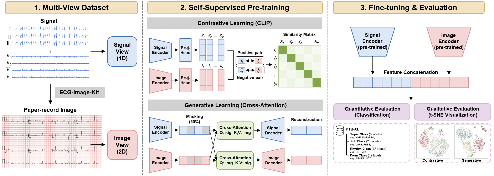

# ECG_SSML
[Self-Supervised Multimodal Learning Method Comparison with ECG Signals and Images](https://www.dbpia.co.kr/journal/articleDetail?nodeId=NODE12989382), KIISE Transactions on Computing Practices (KTCP), 2026.




## Dataset
The CSV files used for training are available [here](https://drive.google.com/drive/folders/14XD8k3BXa7nYv1U3jqDiGRcY72J-N4Wl).

- **MIMIC-IV-ECG** (for pre-training): We downloaded the [MIMIC-IV-ECG](https://physionet.org/content/mimic-iv-ecg/1.0/) dataset as the ECG signals. We used 200,000 samples from the full dataset.
- **PTB-XL** (for fine-tuning): We downloaded the [PTB-XL](https://physionet.org/content/ptb-xl/1.0.3/) dataset, which consists of four subsets: Super, Sub, Form, and Rhythm.

## Pre-training
To run pre-training:
```bash
PYTHONPATH=. torchrun "./pretrain/main.py" \
                      --config_path "./config/pretrain.yaml"
```
Pre-trained weights are available [here](https://drive.google.com/drive/folders/1AC1QJL96RWL3VEunZYNWMBXLL17RrCN3), organized as follows:
- **unimodal_init**: Weights for initializing each encoder before multimodal pre-training
- **contrastive_encoder**: Best image encoder and signal encoder from the contrastive-based method
- **generative_ckpt**: Best pre-trained model from the generative-based method 

## Fine-tuning
To run fine-tuning:
```bash
PYTHONPATH=. torchrun "./finetune/main.py" \
                      --config_path "./config/finetune_con.yaml"
```
To reproduce the **Uni-Modal Concat** baseline in the paper, set `signal_pretrain_weight_path` and `image_pretrain_weight_path` in `finetune_con.yaml` to the **unimodal_init** weights.
